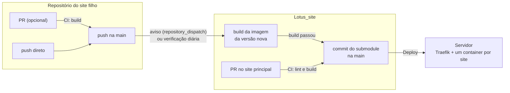

# CI/CD: site principal e sites filhos

Este repositório publica o site da Lotus em `lotusdev.com.br/` e, como submodules em `sites/<nome>`, os sites filhos em `lotusdev.com.br/<nome>/`. A `main` do Lotus_site é o retrato do que está no ar: cada push nela é um deploy.

Cada site filho é publicado a partir da `main` do repositório dele, que recebe push direto ou merge de PR, tanto faz. Quando a `main` do filho avança, o Lotus_site constrói a versão nova, registra o submodule direto na própria `main` e publica, sem PR intermediário.

O exemplo atual é `sites/consultorio-dra-maria-ines`, publicado em `lotusdev.com.br/consultorio-dra-maria-ines/`.



## Estrutura

| Caminho | Papel |
|---|---|
| `sites/<nome>/` | Submodule de um site filho. O nome da pasta é o caminho na URL. |
| `deploy/sites.mjs` | Inventário dos sites: lista, detecta o que mudou, gera o compose de produção, confere commits. |
| `deploy/static/` | Build padrão (Dockerfile + nginx) dos sites filhos sem Dockerfile próprio. |
| `deploy/bump-sites.sh` | Leva o commit novo de um site filho para a `main`. |
| `deploy/server.env.example` | Modelo do `.env` do servidor. |
| `.github/workflows/ci.yml` | CI dos PRs para a `main` do Lotus_site. |
| `.github/workflows/deploy.yml` | Deploy a cada push na `main` (ou manual). |
| `.github/workflows/bump-sites.yml` | Atualiza os submodules quando um site filho avança. |
| `.github/workflows/build-sites.yml` | Build das imagens, compartilhado pelos outros workflows. |
| `templates/site-filho/` | Workflow padrão de um site filho; o [template-site](https://github.com/Lotus-SDS/template-site) já vem com ele. |
| `docs/novo-site.md` | Passo a passo para publicar um site novo. |
| `Dockerfile`, `nginx.conf` | Imagem do site principal. |

## Fluxos do dia a dia

### Mudar o site principal

Branch, PR para a `main`. O CI roda lint e build e constrói a imagem. Depois do merge, o deploy publica.

### Mudar um site filho

1. Faça push na `main` **do repositório do site filho**: direto, ou pelo merge de um PR se quiser revisão antes (no PR, o workflow `Lotus` valida o build).
2. A cada push na `main`, o workflow `Lotus` valida o build e avisa o Lotus_site. Lá, o workflow **Atualizar sites filhos**:
   1. confere que o commit está na `main` do filho;
   2. constrói e publica a imagem;
   3. só se o build passou, faz o commit `chore(sites): atualiza <nome> para <commit>` na `main`, com o link de comparação das mudanças;
   4. dispara o deploy.

Se o build falhar, a `main` do Lotus_site não muda e o site continua na versão anterior. O erro aparece na aba Actions do Lotus_site. Num push direto que quebrou o build, basta outro push na `main` do filho com a correção.

Se o aviso não chegar (secret ausente, falha no GitHub), a verificação diária das 8h faz a mesma coisa. Para não esperar: **Actions → Atualizar sites filhos → Run workflow**, informando o nome do site.

### Adicionar um site filho

Passo a passo completo, a partir do [template-site](https://github.com/Lotus-SDS/template-site): **[novo-site.md](novo-site.md)**.

Em resumo:
1. Crie o repositório do site pelo template.
2. Se ele for privado, configure os tokens.
3. Faça push do site na `main` dele.
4. Registre o submodule na **`main`** do Lotus_site: `git submodule add https://github.com/Lotus-SDS/<repo>.git sites/<nome>`, commit e push.

O site só existe para o Lotus_site depois que o submodule chega na `main`.

### Remover um site filho

```bash
git rm sites/<nome>
```

Depois, PR e merge. O deploy remove o container (`--remove-orphans`).

### Voltar uma versão

- **Site principal:** reverta o PR que trouxe o problema (botão **Revert** no PR) e faça o merge do PR de revert.
- **Site filho:** reverta **no repositório do filho**. O Lotus_site sempre acompanha a `main` do filho: um revert feito só no Lotus_site seria desfeito na próxima verificação.

As imagens antigas continuam no GHCR, então voltar uma versão não exige rebuild. Numa emergência, rodar de novo (**Re-run jobs**) um deploy antigo republica aquela versão na hora. O próximo push na `main` volta a publicar o que estiver nela.

## Regras de um site filho

- **O nome da pasta é o caminho na URL.** Só `a-z`, `0-9` e hífen, direto em `sites/`. Não pode ser `main`, `assets` nem o nome de uma pasta de `public/` do site principal (hoje, `images`): o CI recusa.
- **Só vai para produção o que está na `main` do filho.** O CI recusa um submodule apontando para um commit de outra branch. Para acompanhar outra branch: `git config -f .gitmodules submodule.sites/<nome>.branch <branch>`.
- **Os links do site precisam funcionar dentro de `/<nome>/`.** O jeito mais simples é usar caminhos relativos (`css/styles.css`, não `/css/styles.css`). Um caminho começando com `/` aponta para o site principal. O Traefik redireciona `/<nome>` para `/<nome>/`, para os relativos resolverem certo.
- **O build recebe `BASE_PATH=/<nome>/`**, para ferramentas que geram links absolutos:
  - Vite: `base: process.env.BASE_PATH ?? '/'` no `vite.config.js`;
  - Next.js (export estático): `basePath: process.env.BASE_PATH?.replace(/\/$/, '')`.
- **Como o site é construído**, nesta ordem:
  1. `Dockerfile` na raiz do repositório filho: usado como está, com `--build-arg BASE_PATH=/<nome>/`. As requisições chegam **com** o prefixo (`/<nome>/...`), sem corte. A imagem precisa expor **uma** porta (`EXPOSE`), e o Traefik a descobre sozinho.
  2. `package.json` com script `build`: `npm ci` (ou `npm install`) + `npm run build`. Serve `dist/`, `build/` ou `out/`, o primeiro que existir.
  3. Nenhum dos dois: serve os arquivos do repositório como estão (HTML/CSS/JS puro, caso do consultório).
- Nos casos 2 e 3 o nginx não serve arquivos ocultos (`.impeccable`, `.env`...) e responde caminhos desconhecidos dentro de `/<nome>/` com o `index.html` do site, para SPAs funcionarem.
- **PR no filho é opcional.** Push direto na `main` publica do mesmo jeito; a barreira é o build no Lotus_site, que mantém a versão anterior no ar se falhar. Para tornar a revisão obrigatória, ative em Settings → Rules um PR exigido com o check `Lotus / Build` na `main` do filho.
- Aplicações grandes, com banco e workers (como o DeskcommCRM), não devem virar submodule. Elas sobem em stack própria no mesmo servidor e entram no Traefik só com labels e a rede `web_network`. Precisam aceitar o prefixo no caminho:

  ```yaml
  labels:
    traefik.enable: "true"
    traefik.http.routers.crm.rule: Host(`lotusdev.com.br`) && PathPrefix(`/crm/`)
    traefik.http.routers.crm.entrypoints: websecure
    traefik.http.routers.crm.tls.certresolver: myresolver
  networks: [web_network]   # external: true
  ```

### O exemplo: consultório

Os links do `consultorio-dra-maria-ines` já são relativos e funcionam em `/consultorio-dra-maria-ines/` sem mudança. Três ajustes ficam para o repositório dele:

- `.dockerignore`, para tirar `preview/` da imagem (GIFs e vídeos de vitrine, 120 MB):

  ```
  preview/
  .impeccable/
  *.md
  ```

- `canonical` e `og:url` ainda apontam para `https://DOMINIO/`: devem virar `https://lotusdev.com.br/consultorio-dra-maria-ines/`.
- `og:image` é relativo (`assets/og-capa.jpg`). As redes sociais exigem URL absoluta.

## Configuração (uma vez)

### 1. Servidor

```bash
sudo adduser --disabled-password deploy
sudo usermod -aG docker deploy
sudo mkdir -p /opt/lotus && sudo chown deploy: /opt/lotus
# no seu computador: ssh-keygen -t ed25519 -f lotus-deploy -C github-actions
# e coloque lotus-deploy.pub em /home/deploy/.ssh/authorized_keys
cp deploy/server.env.example /opt/lotus/.env   # e ajuste ACME_EMAIL
```

O servidor precisa de Docker com o plugin `compose`. Não precisa de Node nem do código-fonte: o deploy envia só o `compose.yml` e baixa as imagens prontas do GHCR. O DNS não muda: tudo fica sob `lotusdev.com.br`, com um único certificado.

### 2. Secrets e variáveis do Lotus_site

Em **Settings → Secrets and variables → Actions**:

| Nome | Tipo | Valor |
|---|---|---|
| `DEPLOY_HOST` | secret | IP ou host do servidor |
| `DEPLOY_USER` | secret | `deploy` |
| `DEPLOY_SSH_KEY` | secret | conteúdo da chave privada `lotus-deploy` |
| `DEPLOY_KNOWN_HOSTS` | secret | saída de `ssh-keyscan -t ed25519 <host>` (confira o fingerprint) |
| `LOTUS_BOT_TOKEN` | secret | token do bot (abaixo); só necessário se houver site filho privado |
| `DOMAIN` | variável, opcional | padrão `lotusdev.com.br` |
| `DEPLOY_PATH` | variável, opcional | padrão `/opt/lotus` |
| `DEPLOY_PORT` | variável, opcional | padrão `22` |

O login no GHCR e o push na `main` usam o token temporário do próprio workflow: não há senha de registry para guardar.

### 3. Token do bot (`LOTUS_BOT_TOKEN`)

Os sites filhos usam esse token para avisar o Lotus_site de que a `main` deles avançou. O Lotus_site usa o mesmo token para clonar sites filhos privados.

Crie um *fine-grained personal access token* com dono **Lotus-SDS**, acesso ao `Lotus_site` e aos sites filhos privados, e permissão **Contents: read and write**. Coloque-o como secret em cada site filho (e no Lotus_site, se algum filho for privado). Um GitHub App faz o mesmo papel sem depender da conta de uma pessoa e é a evolução natural quando houver mais sites.

Sem o token tudo continua funcionando, só que a versão nova de um site filho espera a verificação diária (ou um **Run workflow** manual).

### 4. Regras de branch

- **Sites filhos:** opcional. Sem regra, push direto na `main` publica; com uma regra exigindo PR, a revisão passa a ser obrigatória.
- **Lotus_site:** o commit automático dos submodules vai direto para a `main`. Uma regra que exija PR nela precisa liberar o push do workflow; sem isso, a atualização dos sites filhos falha no push e o site continua na versão anterior.

No GitHub Free, regras de branch só existem para repositórios públicos: o consultório já pode usá-las, e o Lotus_site, que é privado, só com um plano pago.

### 5. Migração do deploy atual

O stack antigo (o `docker-compose.yml` que ficava na raiz) ocupa as portas 80 e 443. Na virada:

1. Faça os passos 1 a 3.
2. Na pasta antiga do servidor, rode `docker compose down`. Opcional: copie `letsencrypt/acme.json` para `/opt/lotus/letsencrypt/` (com `chmod 600`) para reaproveitar o certificado atual.
3. Faça o merge na `main` (ou **Actions → Deploy → Run workflow**). O site fica fora do ar por cerca de um minuto.

Os workflows de deploy e de atualização só passam a valer depois de estarem na `main`. O CI já roda no próprio PR que os introduz.

## Limites conhecidos

- O deploy reinicia só os containers com imagem nova, mas esse site fica fora do ar por alguns segundos durante a troca.
- O Lotus_site é privado: no GitHub Free, ele tem 2.000 minutos de Actions por mês. Uma atualização de site filho gasta poucos minutos, e a verificação diária sem novidades, cerca de um minuto.
- Próximo passo natural: ambiente de preview por PR (`lotusdev.com.br/pr-12/`) usando a mesma estrutura.
